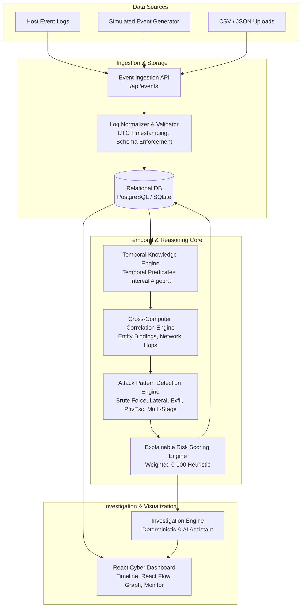
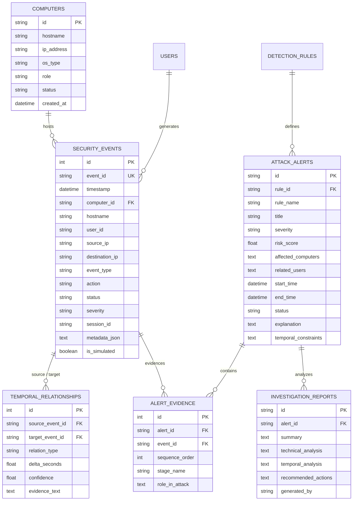

# System Architecture Document

## Intelligent Cyberattack Detection Using Temporal Knowledge Representation

---

### 1. Architectural Overview

The system is designed as an end-to-end, multi-stage cybersecurity monitoring and investigation platform. Rather than relying purely on isolated threshold alerts or point-in-time statistical anomalies, the system treats cybersecurity logs as **temporal facts** and applies **temporal knowledge representation and reasoning** (incorporating Allen's Interval Algebra and point-based temporal predicates) to correlate suspicious activities across multiple hosts.

---

### 2. Pipeline Stages

1. **Log Ingestion & Normalization**:
   - Ingests events from REST endpoints, bulk uploads, or simulation engines.
   - Normalizes timestamps to UTC datetime objects.
   - Validates event types (`FAILED_LOGIN`, `SUCCESSFUL_LOGIN`, `REMOTE_LOGIN`, `PRIVILEGE_ESCALATION`, `SUSPICIOUS_PROCESS`, `FILE_ACCESS`, `SENSITIVE_FILE_ACCESS`, `LARGE_DATA_TRANSFER`, `UNUSUAL_NETWORK_CONNECTION`, `MALWARE_INDICATOR`).
   - Dynamically registers unknown computers and security identities.
   - Rejects malformed and duplicate events.

2. **Temporal Knowledge Representation**:
   - Represents each event as a time-dependent fact: $E_i = \langle \text{id}, t_i, \text{type}, \text{host}, \text{user}, \text{session}, \text{action} \rangle$.
   - Computes pairwise temporal relations between events occurring within a sliding time window:
     - `BEFORE(e1, e2)`
     - `AFTER(e1, e2)`
     - `SIMULTANEOUS(e1, e2)` (within 2s tolerance)
     - `WITHIN_TIME_WINDOW(e1, e2, W)`
     - `OVERLAPS(i1, i2)`
     - `CAUSALLY_RELATED_CANDIDATE(e1, e2)`
   - Causal candidate evaluation requires chronological succession, temporal proximity, entity correlation (same user, session, host, or network path), and semantically plausible lifecycle transitions.

3. **Cross-Computer Correlation**:
   - Tracks lateral pivots and attacker movement across endpoints (e.g. Host A $\rightarrow$ Host B $\rightarrow$ Host C).
   - Validates entity continuity via matching credentials, session tokens, or direct socket links (`e1.destination_ip == e2.source_ip`).
   - Computes normalized correlation strength (0.0 to 1.0) based on user and session persistence across machines.

4. **Attack Detection & Reasoning**:
   - Executes 5 configurable detection rules:
     - **Brute-Force Account Compromise**: $\ge 3$ failed logins followed by successful login for same user within time window (default 10m).
     - **Lateral Movement**: Initial compromise/login on Host A followed by remote login on Host B within window (default 30m).
     - **Data Exfiltration**: Sensitive file access followed by large outbound network transfer within window (default 20m).
     - **Privilege Escalation**: Authentication followed by privilege change followed by restricted asset access within window (default 15m).
     - **Multi-Stage Coordinated Attack**: 5-stage sequential APT progression spanning brute force, breach, lateral movement, database dump, and exfiltration.
   - Enforces duplicate prevention to eliminate redundant alerts for identical event sets.

5. **Explainable Risk Scoring**:
   - Calculates a deterministic heuristic risk score (0–100) based on rule base score, event volume, maximum event severity, temporal consistency, multi-host propagation, correlation strength, sensitive asset bonus, and pattern completeness.
   - Classifies threats into: Low (0–39), Medium (40–69), High (70–89), and Critical (90–100).

6. **Incident Investigation & Reporting**:
   - Synthesizes structured forensic reports detailing executive summary, technical breakdown, temporal constraint proofs, and defensive containment playbooks.
   - Features deterministic rule-based explanations and optional LLM assistant integration.

7. **SOC Dashboard & Visualization**:
   - React 19 + Tailwind CSS + React Flow + Recharts.
   - Interactive live event monitor, chronological attack timeline, topological React Flow network graph, simulation laboratory, and detection rule configuration.

---

### 3. Database Entity Relationship Diagram

---

### 4. REST API Endpoint Specifications

| Endpoint | Method | Description |
|---|---|---|
| `/api/health` | `GET` | Service & database health verification |
| `/api/events` | `GET` | Filterable, paginated security log stream |
| `/api/events` | `POST` | Ingest single security event |
| `/api/events/bulk` | `POST` | Ingest multiple security events |
| `/api/events/upload` | `POST` | Upload CSV / JSON dataset file |
| `/api/computers` | `GET` | List monitored enterprise endpoints |
| `/api/computers/{id}` | `GET` | Retrieve single endpoint metadata |
| `/api/detection/run` | `POST` | Execute temporal reasoning & detection |
| `/api/detection/rules` | `GET` | List configurable detection rules |
| `/api/detection/rules/{id}` | `PATCH` | Update rule thresholds and time windows |
| `/api/detection/results` | `GET` | Detection statistics summary |
| `/api/alerts` | `GET` | List detected cyberattack alerts |
| `/api/alerts/{id}` | `GET` | Retrieve alert with sequential evidence |
| `/api/alerts/{id}` | `PATCH` | Update alert triage status |
| `/api/timeline` | `GET` | Retrieve chronological timeline and causal links |
| `/api/network/graph` | `GET` | Topological React Flow graph data |
| `/api/simulation/start` | `POST` | Run normal traffic or inject attack scenario |
| `/api/simulation/stop` | `POST` | Stop active simulation |
| `/api/simulation/reset` | `POST` | Reset demo database to clean baseline |
| `/api/investigation/explain`| `POST` | Generate evidence-grounded report |
| `/api/investigation/{id}` | `GET` | Retrieve forensic investigation report |
| `/api/dashboard/summary` | `GET` | SOC high-level summary metrics |
| `/api/dashboard/trends` | `GET` | Time-series event and alert trend buckets |
